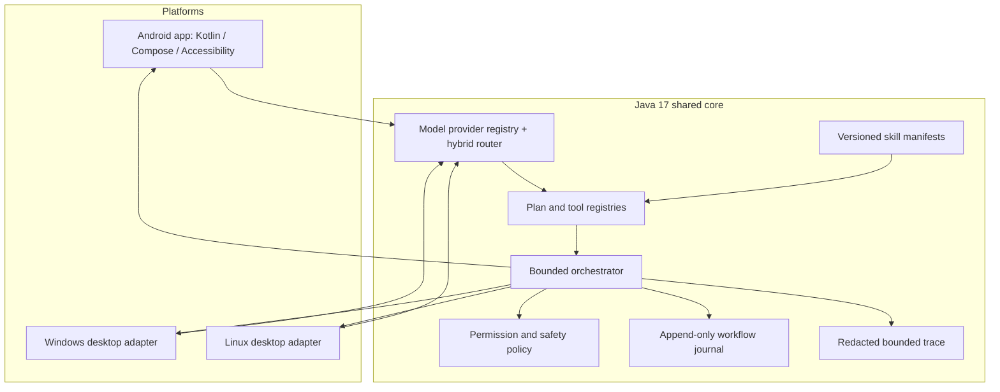

# ULTRON 10.0 — Unified Agent Release

**Release type:** architecture and source milestone, built incrementally on the supplied ULTRON 9.0 Phase 1 source.  
**Version:** Android `10.0.0` / versionCode `100`; desktop UI `10.0`.  
**Design rule:** ULTRON remains the primary project. Reference projects are not substituted, copied wholesale, or used to overwrite ULTRON's package structure, persistence, permissions, or workflows.

## Release architecture



The platform adapters remain responsible for OS-specific APIs. A shared plan is not permission to assume that Android Accessibility, Windows UI Automation, Linux AT-SPI, X11, and Wayland behave identically.

## Included implementation

### Intelligence and routing
- Provider-neutral `ModelProvider`, `ModelPrompt`, request metadata, capability descriptors and thread-safe registry.
- Local-first hybrid routing. Cloud use requires provider configuration and explicit opt-in; private data blocks cloud routing.
- Desktop OpenAI-compatible client now builds request JSON with Gson and parses the documented `choices[0].message.content` structure rather than using a regular expression.
- Desktop planner emits a bounded shared `AgentPlan`, checks the tool allowlist, and accepts only primitive stringified arguments.
- Capabilities not actually probed remain conservatively false/zero. This is not a claim that every endpoint supports streaming, tool calling, vision or JSON mode.

### Shared agent and execution safety
- Existing `AgentOrchestrator` provides bounded step execution with observe → permission gate → execute → observe/verify, duplicate step-ID rejection and emergency stop.
- Existing `AgentRuntime` remains the desktop single-action path and retains a user permission prompt and verification check.
- New `PermissionPolicy` exposes deny-by-default policy decisions for consequential operations and blocks arbitrary shell/exec-style actions. Callers must explicitly wire the policy to their platform permission UI; the presence of this API alone does not mean every legacy tool now uses it.
- No LLM-generated arbitrary shell command or unrestricted OS command interface is introduced.

### Memory, skills and durable work
- Existing Android SQLite memory/session/task queue files are retained without destructive schema edits.
- New `SkillManifest` adds versioned metadata and declared capability requirements. It is a schema/API, not a claim that all legacy skills have been migrated or published.
- New `WorkflowJournal` provides append-only, fsync-backed event records and a recovery snapshot. Interrupted in-flight work becomes `RECOVERY_REQUIRED`; actions are not automatically replayed after restart.
- The journal is a shared-core facility. Android's existing SQLite/WorkManager queue remains the active Android persistence path until a separately tested migration/adapter is implemented.

### Diagnostics and privacy
- New `AgentTrace` provides bounded in-memory diagnostic entries with credential/email redaction. It intentionally does not accept prompts, screenshots or raw model payloads.
- Workflow journal details are length-bounded and redact common credential/email patterns. Do not put personal content or secrets into event details; redaction is best-effort, not a DLP guarantee.

### Platform status
- Android: existing Kotlin/Compose app, voice, AccessibilityService, task queue, memory and model client retained. New app version metadata is `10.0.0`. Real device verification is required.
- Windows: existing Java AWT desktop adapter and allowlisted app launching retained. This is not full Windows UI Automation; UIA integration remains outstanding.
- Linux: existing Java AWT adapter retained; Wayland marks input/screen capabilities temporarily unavailable where not guaranteed. This is not full AT-SPI integration.
- Cross-device pairing, encrypted synchronization, device identity, remote task transport and conflict resolution are not implemented in this release. Local-first means local inference/storage is preferred; it does not mean devices are already paired.

## Safety invariants
1. Observe before acting.
2. Validate tool identity and arguments against a registered allowlist.
3. Apply the platform permission gate; consequential actions require explicit confirmation and, where required, an authenticated session.
4. Execute a bounded action once.
5. Independently verify the resulting state.
6. On uncertain outcome, stop and request review; never blindly replay a click, message, purchase, payment, delete, or other consequential action.
7. Emergency STOP must remain available to the user.
8. Cloud routing is independent from action authorization and requires explicit consent; private data must remain local.

## Build and run

Open the `agent-main` folder in Android Studio. Desktop and core builds use Java 17. Commands:

```bash
chmod +x ./gradlew
./gradlew :core:test :desktop:installDist
./gradlew :app:testDebugUnitTest :app:assembleDebug
```

Android debug APK path after a successful build:
`app/build/outputs/apk/debug/app-debug.apk`

Desktop run:
`./gradlew :desktop:run`

A successful local build is not asserted in this archive. The previous build environment could not download Gradle 8.13 from `services.gradle.org` because DNS/network access was unavailable. CI is configured to build Android, Windows and Linux packages on GitHub-hosted runners; inspect the workflow run and its artifacts before calling those platform packages verified.

## Validation matrix

| Area | Source state | Validation in this release environment |
|---|---|---|
| Existing ULTRON source preservation | Retained | ZIP contents inspected; source tree incrementally edited |
| Shared Java core | Existing + new APIs | `javac --release 17` compilation required and recorded in build report |
| Workflow journal | New | Unit tests authored; standalone smoke test required |
| Permission policy | New | Unit tests authored; integration into all UI gates remains incomplete |
| Skill manifest | New | Java compilation; legacy skill migration not done |
| Desktop JSON request/response | Hardened | Gradle desktop compile unavailable without wrapper distribution |
| Android APK | Existing app + version metadata | Not built here; requires Android SDK + Gradle |
| Windows UI Automation | Not complete | Requires native UIA adapter and Windows runtime tests |
| Linux AT-SPI | Not complete | Requires AT-SPI adapter and X11/Wayland runtime tests |
| Device pairing/sync | Not implemented | Requires protocol, identity, cryptographic review and multi-device tests |
| Voice, Accessibility and messaging | Existing ULTRON code | Requires real-device and target-app version tests |

## Known limitations / next engineering work
- Wire `PermissionPolicy` into every Android `CommandExecutor`/tool confirmation path and desktop `AgentRuntime` without weakening existing confirmation prompts.
- Add Android `ModelProvider` adapter against the existing `LlmClient` and unify settings without duplicating secrets or endpoint configuration.
- Connect `WorkflowJournal` to Android task persistence through a tested adapter; do not migrate or delete existing SQLite records.
- Add native Windows UIA and Linux AT-SPI backends; retain AWT fallback only where its capabilities are available.
- Add explicit model endpoint health/capability probing, provider mock HTTP tests, model timeout/cancellation and structured error handling.
- Implement secure device pairing and sync only after threat modeling, identity lifecycle, key storage, replay protection and conflict semantics are designed.
- Add end-to-end tests for message confirmation, task recovery, emergency stop, local-only privacy mode and verification failure.
- Confirm repository licensing before redistribution; no root license file was present in the audited ULTRON archive.

## Release honesty

ULTRON 10.0 is a consolidated source/architecture milestone, not a certified production release for all three operating systems. Do not distribute it as a fully verified autonomous system until the CI builds, platform-specific integration tests, security review and real-device tests pass.
