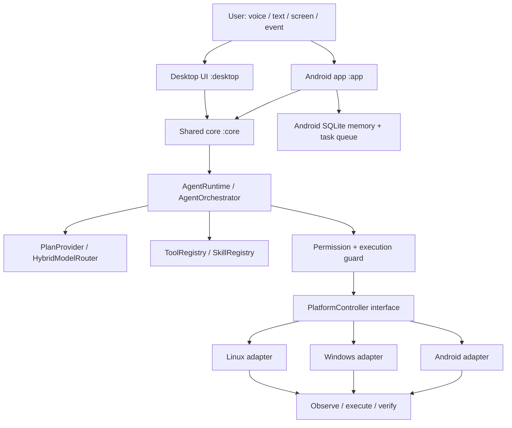

# ULTRON 9.0 — Phase 0 Architecture Audit

**Audit date:** 2026-11-10  
**Primary source:** `ULTRON_8_8_SHARED_AGENT_CORE.zip` (the only project foundation)  
**References:** OpenJarvis, JAVIS OS, J.A.R.V.I.S  
**Decision:** Preserve ULTRON's Gradle multi-module architecture and Android identity. No reference project files or dependency manifests are copied into ULTRON.

## 1. Executive summary

ULTRON is already a native Android + JVM desktop + platform-neutral Java core project. It is not a blank project and must not be replaced.

The current foundation contains:
- `:app`: native Android/Kotlin application (`com.ultron.app`), Compose UI, accessibility, voice, local/cloud LLM client, model package management, memory and task persistence.
- `:core`: Java 17 platform-neutral runtime, agent orchestration, tool/skill registries, model routing and platform contracts.
- `:desktop`: Java 17 desktop UI and Windows/Linux controller implementations.
- `.github/workflows/build.yml`: separate Android, Windows and Linux CI jobs.

ULTRON 8.8's shared core is a meaningful architectural milestone, but its own milestone notes explicitly state that several integrations are contracts/foundations rather than finished native capabilities. In particular, the current shared core's model router and Android/desktop adapters need end-to-end wiring and verification.

## 2. ULTRON architecture inventory

| Area | Existing implementation | Audit finding |
|---|---|---|
| Shared brain/runtime | `core/AgentRuntime.java`, `core/agent/AgentOrchestrator.java` | Platform-neutral boundary exists. Runtime dispatch is bounded and checks stop state, permission, observation and verification. |
| Model routing | `core/ai/HybridModelRouter.java`, `ModelMode`, `ModelRequest`, Android `LlmClient.kt`, desktop `DesktopModelClient.java` | Local/cloud/AUTO concepts exist. Desktop planner connection and provider capability discovery remain incomplete per `HYBRID_AI_SETUP.md`. |
| Tools | `core/agent/AgentTool.java`, `ToolRegistry.java`, app `ToolRegistry.kt`, `CommandParser.kt`, `CommandExecutor.kt` | Registries and deterministic command execution exist, but the two platform registries must be reconciled through adapters, not replaced. |
| Skills | `core/agent/Skill.java`, `SkillRegistry.java` | Declarative shared skill catalogue exists; lifecycle/versioning/evaluation and cross-platform registration are not yet demonstrated. |
| Planning/orchestration | `AgentPlan`, `AgentStep`, `PlanProvider`, `AgentOrchestrator`; Android `UniversalAgentPlanner`, `UniversalAgentLoop` | Shared orchestration foundation exists. Full persistent multi-step planning and cross-platform task state need integration. |
| Task queue | Android `AgentTaskQueue.kt`, `AgentTaskWorker.kt`, `TaskContextStore.kt`, `AutomationStateMachine.kt` | Android SQLite + WorkManager persistence exists. A shared desktop task queue/checkpoint model is not established. |
| Memory | Android `MemoryDatabase.kt`, `LongTermMemoryManager.kt`, `PersonalInstructionManager.kt`, `SessionManager.kt` | SQLite-backed sessions, messages, instructions and key/value memories exist. Semantic retrieval, lifecycle controls, backup/export and shared desktop memory remain incomplete or unverified. |
| Voice | `VoiceManager.kt`, `UltronListenService.kt`, `VoskEngine.kt`, `WhisperLocalEngine.kt`, `SpeechTextNormalizer.kt`, `TtsEngine.kt` | Android voice stack exists. Physical-device lifecycle, VAD, interruption, candidate ranking and media coexistence need tests. |
| Screen understanding | Android `ScreenUnderstanding.kt`, `UltronAccessibilityService.kt`, ML Kit dependency; shared `ScreenUnderstandingProvider` | Android primitives exist; shared provider wiring and actual cross-platform observation are incomplete. |
| Desktop controls | `AbstractDesktopController`, `WindowsPlatformController`, `LinuxPlatformController` | Allowlisted application launch and AWT input/screen path exist. Windows UI Automation and Linux AT-SPI/Wayland-native paths are not present in the inspected controller classes. Wayland limitation is explicitly reported. |
| Research | `GoogleSearchClient.kt`, `ResearchProvider`, `ResearchAnswerSynthesis.kt` | Search and synthesis components exist. Full browser navigation, source verification and citations need validation. |
| Security | `AgentExecutionGuard`, `SecureEnvelope`, `GhostModeManager`, Android permissions/Keystore cloud config, confirmation flows | Multiple controls exist. Need unified risk schema, structured audit coverage, cloud data classification and tests across all execution paths. |
| Diagnostics/performance | `DiagnosticManager.kt`, `PerformanceProfile.kt`, `LogStore.kt` | Basic diagnostics and profiles exist; resource/latency metrics need consistent cross-platform instrumentation. |

### 2.1 Existing architecture diagram

## 3. Reference project findings

### OpenJarvis (Apache-2.0)

The repository is a modular Python assistant backend with inference engines, composable agents, tools, memory backends, evaluation/telemetry and sandboxing. Its documented patterns worth adapting:
- Provider-independent `InferenceEngine` abstraction and capability-aware model selection.
- Simple-vs-tool-using agent separation; bounded tool turns.
- Explicit agent context/result contracts.
- Persistent SQLite FTS5 memory with BM25; optional dense and hybrid retrieval rather than mandatory heavy vector dependencies.
- Composable guardrail wrappers, scanner findings, redaction/block modes and audit logging.
- Sandbox isolation and file-path sensitivity policy.
- Event-based tracing/evaluation.

Do not port its Python package, Rust extension, desktop frontend, or its dependency graph into the Kotlin/Java Gradle project. Reimplement selected contracts natively or adapt concepts behind existing ULTRON interfaces. Any copied Apache-2.0 source must retain copyright/license notices and include required NOTICE attribution; no source copying is proposed in this audit.

### JAVIS OS (MIT)

The repository is a large Python/FastAPI application with a plugin/MCP hub, persistent SQLite task queue, configurable brains/state separation, workflow history, skill/plugin system, audit and extensive operational tests. Useful patterns:
- One tool hub as the single discovery/dispatch and permission-enforcement point.
- Durable SQLite task state with transactional claims, compare-and-set transitions, idempotency and queue conflict handling.
- Separate mutable runtime state from user-authored/syncable knowledge and immutable application code.
- Workflow execution history with step-level outputs and verification state.
- Plugin schemas, owner-only tools, safe/read-only modes and audit records.
- Operational regression fixtures and security-focused testing.

JAVIS OS is not a native Android/Windows/Linux agent core that can be dropped into ULTRON. Its FastAPI, Python and deployment stack must not be merged into ULTRON's Gradle modules. Recreate only the applicable data and lifecycle patterns in ULTRON's existing SQLite/core abstractions.

### J.A.R.V.I.S-master (MIT)

The inspected project is a small 2020-era Python voice-assistant prototype. Actual code includes SpeechRecognition/Google recognition, pyttsx3 TTS, browser opening, YouTube search URL construction, OCR with Tesseract/OpenCV, screenshot/CPU helpers, weather/news/dictionary functions, email and face-recognition scaffolding.

Important safety/quality findings from source inspection:
- `jarvis.py` includes placeholder hard-coded SMTP login strings and direct email sending.
- It invokes `os.system` for poweroff and `exec(open(...).read())` for downloader execution.
- Helpers use `pyautogui` and microphone capture with no ULTRON-grade permission/verification framework.
- `youtube.py` opens a search results URL; it does not verify video selection or playback.
- Pinned dependencies are old (e.g. SpeechRecognition 3.8.1, PyAudio 0.2.11, pytube 11.0.1, Pillow 8.3.2); some are platform-specific.
- OCR script has a Windows-specific Tesseract path and an interactive camera loop.

Therefore, reuse only high-level workflow ideas (voice intent → safe tool → observed result), not its command execution, credential, or dependency implementation. ULTRON already has a substantially more advanced voice/accessibility path.

## 4. Feature-by-feature integration matrix

| Capability | ULTRON status | Reference insight | Adaptation to ULTRON | Candidate ULTRON files |
|---|---|---|---|---|
| Provider abstraction/capability discovery | Partial: local/cloud routing exists; capability discovery and desktop planner connection incomplete | OpenJarvis engine abstraction and engine capability contract | Add provider capability metadata/probes to existing `ModelRoute` and adapter contracts; preserve LOCAL as no-cloud mode | `core/ai/HybridModelRouter.java`, `ModelRoute.java`, `ModelRequest.java`, `app/LlmClient.kt`, `desktop/ai/DesktopModelClient.java` |
| Bounded agent loop | Partial: shared orchestrator + Android loop | OpenJarvis tool-using agent with max turns; JAVIS bounded workflow execution | Consolidate step/turn budgets and cancellation at shared core boundary | `core/agent/AgentOrchestrator.java`, `AgentPlan.java`, `AgentStep.java`, `AgentRuntime.java`, `app/agent/UniversalAgentLoop.kt` |
| Unified tool registry and permission policy | Partial: shared and Android registries coexist | JAVIS single MCP hub and tool policy; OpenJarvis tool executor | Make platform adapters register into one core registry; attach schema, permissions, risk, timeout and verification metadata | `core/agent/ToolRegistry.java`, `AgentTool.java`, `app/ToolRegistry.kt`, `app/tools/CommandExecutor.kt`, `AgentExecutionGuard.kt` |
| Durable cross-platform tasks | Partial: Android SQLite/WorkManager queue; no shared desktop queue established | JAVIS transactional SQLite queue, idempotency, CAS transitions, workflow history | Design versioned shared task records and persistence interface; Android implementation wraps/migrates existing DB, desktop gets separate local store | `app/agent/AgentTaskQueue.kt`, `TaskContextStore.kt`, `AutomationStateMachine.kt`, new core task contracts, desktop adapter |
| Persistent memory/retrieval | Partial: Android SQLite memories/sessions; no semantic index demonstrated | OpenJarvis SQLite FTS5/BM25 and hybrid retrieval; JAVIS brain/state separation | Add optional FTS5-style or portable lexical index behind `MemoryRetriever`; preserve existing tables and migrate additively | `app/memory/MemoryDatabase.kt`, `LongTermMemoryManager.kt`, `SessionManager.kt`, new core memory interfaces |
| Skills/workflow versioning | Partial: shared Skill/SkillRegistry | JAVIS versioned plugins/workflows and workflow history; OpenJarvis reusable skills | Add skill metadata/version/test contracts; all skills dispatch through existing tool registry and permission gate | `core/agent/Skill.java`, `SkillRegistry.java`, `AgentOrchestrator.java` |
| Security scanning and audit | Partial: guard/secure envelope/Keystore/confirmation exist | OpenJarvis composable scanners + audit; JAVIS hub policy/audit | Add central risk classification and structured audit events; never weaken existing gates | `core/SecureEnvelope.java`, `app/agent/AgentExecutionGuard.kt`, `app/GhostModeManager.kt`, `LogStore.kt`, `core/agent/AgentTool.java` |
| Screen observation/computer use | Partial: Android accessibility/ML Kit; desktop AWT only | OpenJarvis sandbox/file policy; J.A.R.V.I.S OCR/screenshot concept | Implement observation providers per OS; Windows UIA and Linux AT-SPI/portal adapters, with explicit Wayland capability reporting | `ScreenUnderstanding.kt`, `UltronAccessibilityService.kt`, `ScreenUnderstandingProvider.java`, `AbstractDesktopController.java`, `WindowsPlatformController.java`, `LinuxPlatformController.java` |
| Voice and speech alternatives | Partial: Vosk/Whisper, normalizer, TTS | J.A.R.V.I.S speech/TTS pipeline (legacy) | Extend existing ULTRON speech candidate pipeline and queue/interruption tests; do not import legacy engine | `VoiceManager.kt`, `UltronListenService.kt`, `VoskEngine.kt`, `WhisperLocalEngine.kt`, `SpeechTextNormalizer.kt`, `TtsEngine.kt` |
| Media verification | Partial: deterministic media commands; current README documents opening/search and tap behavior | J.A.R.V.I.S YouTube search opens results only | Require selected-title observation and post-action playback verification; keep ambiguity clarification | `CommandParser.kt`, `CommandExecutor.kt`, `ScreenUnderstanding.kt`, `AgentOrchestrator.java` |
| Research/citations | Partial: Google search + synthesis, shared ResearchProvider | OpenJarvis research agents/tools and traceability | Add source metadata/date and independent verification through existing provider contract | `GoogleSearchClient.kt`, `ResearchAnswerSynthesis.kt`, `ResearchProvider.java` |
| Evaluation/tracing | Partial: LogStore/diagnostics and tests; unified trace/eval not established | OpenJarvis event bus/evaluation/telemetry; JAVIS test fixtures and run history | Add local trace IDs and outcome records, then offline deterministic regression suite | `LogStore.kt`, `DiagnosticManager.kt`, `core/agent/AgentOrchestrator.java`, tests |
| Windows/Linux native accessibility | Missing/limited in inspected code | OpenJarvis system access and sandbox patterns; J.A.R.V.I.S generic PyAutoGUI | Native Windows UIA and Linux AT-SPI/X11/portal implementations; keep existing controller API and mark unsupported states | `desktop/WindowsPlatformController.java`, `LinuxPlatformController.java`, `AbstractDesktopController.java` |
| Cross-device pairing | Not implemented per ULTRON 8.6 status | JAVIS authenticated hub/audit patterns | Later phase: explicit pairing, authenticated encrypted envelope, replay protection and task ownership; no implicit remote control | `core/SecureEnvelope.java`, `core/PlatformAction.java`, new pairing/transport modules |

## 5. Dependency, license and compatibility report

| Project | License found | Compatibility decision |
|---|---|---|
| ULTRON ZIP | No root `LICENSE` file was present in the inspected archive | **Blocking release/legal metadata gap.** Confirm ULTRON's intended license before redistributing the upgraded source. Do not assume an open-source license. |
| OpenJarvis | Apache License 2.0 | Concepts can be independently implemented. If source is copied later, preserve notices, include license/NOTICE obligations and review transitive component licenses. |
| JAVIS OS | MIT (copyright 2026 Nguyễn Minh Quý) | Reuse of selected code is possible subject to retaining copyright and license notice. Prefer independent native implementation to avoid importing its Python runtime. |
| J.A.R.V.I.S | MIT (copyright 2020 GauravSingh9356) | Same MIT notice requirement if code is copied. Legacy Python dependencies and unsafe command patterns are not suitable for direct integration. |

**No dependency merge is recommended.** ULTRON uses Gradle, Kotlin 2.2.20, Android Gradle Plugin 8.13.0, Java 17, Android SDK 36, OkHttp, Gson, coroutines, Vosk and ML Kit. OpenJarvis and JAVIS OS are Python ecosystems; J.A.R.V.I.S is a legacy Python/pip project. Their package sets must not be added wholesale to ULTRON.

## 6. Risks and migration constraints

1. **Data preservation:** `ultron_memory.db` (schema v2) and `ultron_agent_tasks.db` (schema v1) are existing user-data stores. Any future schema change must be additive, versioned, backed up and migration-tested. Never replace the database files.
2. **Duplicate registries:** Android and shared core currently have separate tool registries. Integrate with adapters and a staged parity test; do not delete either registry before migration.
3. **Model routing mismatch:** `HYBRID_AI_SETUP.md` states that the desktop model client is not yet connected to a natural-language planner. This is a concrete phase-1 gap.
4. **Native platform gaps:** current desktop controllers use Java AWT; Linux explicitly marks screen/input temporarily unavailable in Wayland sessions. Do not claim native UIA/AT-SPI support.
5. **Permission semantics:** Android runtime permissions, desktop confirmation prompts and shared core permission callbacks are not yet proven to be one policy. Centralize metadata while retaining OS enforcement.
6. **Voice/media concurrency:** wake-word, foreground service, microphone and TTS/audio focus behavior require physical Android validation.
7. **License uncertainty:** ULTRON has no root license file in this archive. Decide project license before publishing derivative work.
8. **Build verification blocker:** the wrapper requests Gradle 8.13 from `services.gradle.org`; this environment cannot resolve that host. No Gradle tests/builds have passed in this audit.

## 7. Recommended implementation sequence

### Phase 1 — Intelligence (next)
- Define model capability descriptors (tool calls, JSON mode, vision, streaming, context/output limits, health/latency).
- Connect desktop model client to the shared plan provider without bypassing permission gates.
- Add deterministic provider-routing tests for LOCAL/CLOUD/AUTO and sensitive-data handling.
- Add constrained structured-output parsing for backends without native tool calling.

### Phase 2 — Memory and skills
- Introduce a shared memory interface; retain Android SQLite schema and add a tested additive migration for FTS/search metadata.
- Add skill version, compatibility, permission and test metadata.
- Add workflow outcome records and memory export/backup before introducing embeddings.

### Phase 3 — Autonomy
- Introduce shared task contracts, idempotency keys, bounded retries, checkpoints and cancellation.
- Bridge existing Android queue without losing task rows.
- Add desktop persistence and recovery tests.

### Phase 4 — Computer use
- Wire Android observation provider into shared contract.
- Implement Windows UI Automation and Linux AT-SPI/X11/portal adapters as separate native modules.
- Add observe-before/after and target-state verification tests.

### Phase 5 — Platform completion
- Physical Android voice/audio tests.
- Windows and Linux native integration tests.
- Secure explicit device pairing and cross-device task ownership.
- Platform-specific adaptive UI and independent installers.

### Phase 6 — Hardening
- Security review, privacy/cloud-consent tests, regression suite, performance metrics, release builds and documentation.

## 8. Phase 0 acceptance status

| Audit item | Status |
|---|---|
| Extract all four archives separately | Done |
| Inventory directory structures | Done |
| Inspect ULTRON build configuration and modules | Done |
| Inspect reference READMEs, architecture docs, code and dependency manifests | Done for primary architecture and targeted relevant source; not every file in the large reference repositories |
| Inspect license files | Done; ULTRON license missing |
| Verify reference capabilities against implementation | Done for the integration candidates listed above |
| Create integration matrix | Done |
| Identify conflicts and migration risks | Done |
| Run ULTRON tests/build | Blocked: Gradle 8.13 distribution download fails because `services.gradle.org` is unreachable; wrapper invocation also requires `bash ./gradlew` because executable bit is absent in extracted archive |
| Modify application source | Not performed in Phase 0; audit-only change avoids unvalidated architectural edits |

**Phase 0 conclusion:** ULTRON remains the sole foundation. The next safe engineering milestone is Phase 1 provider capability discovery and desktop planner wiring, after restoring a usable Gradle 8.13 distribution or running the build in network-enabled CI. Existing source and databases remain untouched.
