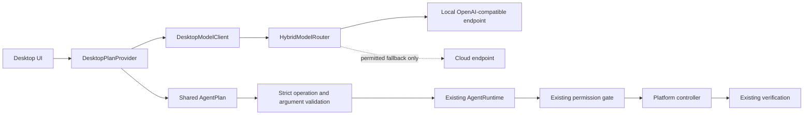

# ULTRON 9.0 — Phase 1 Intelligence Milestone

**Status:** implementation increment complete; Gradle verification blocked by unavailable Gradle 8.13 distribution download.
**Foundation:** ULTRON 9.0 Phase 0 audited source ZIP. No reference project was substituted or copied wholesale.

## Implemented

1. **Provider-neutral core contract**
   - `ModelProvider` and `ModelPrompt` define a platform-neutral inference boundary.
   - `ModelCapabilities` describes provider identity, locality, streaming, tool calling, JSON mode, vision and token limits.
   - Unknown capabilities and token limits remain false/zero rather than being guessed.
   - `ModelProviderRegistry` provides thread-safe registration, duplicate-ID rejection and deterministic capability discovery.

2. **Desktop adapter integration**
   - Existing OpenAI-compatible desktop model client now implements the shared `ModelProvider` contract.
   - Desktop startup registers the configured model provider and reports its conservative capability descriptor.
   - `DesktopPlanProvider` implements the existing shared `PlanProvider` interface and returns an immutable `AgentPlan`.
   - The desktop natural-language flow now uses this shared plan contract rather than parsing a direct action JSON response in the Swing UI.

3. **Safety boundaries retained and tightened**
   - The planner is limited to one desktop step because the existing desktop UI/runtime only supports one action per request.
   - Tool IDs must appear in the explicitly supplied allowlist.
   - Plan arguments must be primitive values; unsupported structures are rejected.
   - The desktop UI independently validates the operation and exact argument-key set before creating a `PlatformAction`.
   - All resulting actions still pass through the existing `AgentRuntime` permission prompt and verification path.
   - Sensitive-looking requests are marked private before routing. Existing local-first routing and cloud-consent/privacy checks remain authoritative.
   - No LLM-generated shell or arbitrary OS command execution was added.

4. **Tests added**
   - `ModelProviderRegistryTest` checks capability discovery, conservative unsupported-feature defaults and duplicate registration rejection.

## Files added/changed

- Added `core/.../ai/ModelCapabilities.java`
- Added `core/.../ai/ModelPrompt.java`
- Added `core/.../ai/ModelProvider.java`
- Added `core/.../ai/ModelProviderRegistry.java`
- Added `core/src/test/.../ai/ModelProviderRegistryTest.java`
- Added `desktop/.../ai/DesktopPlanProvider.java`
- Updated `desktop/.../ai/DesktopModelClient.java`
- Updated `desktop/.../UltronDesktop.java`

## Verification

- `javac --release 17` compiled all `core/src/main/java` sources successfully.
- Gradle tests and desktop compilation could not be run: the wrapper attempted to download Gradle 8.13 from `services.gradle.org`, but DNS/network access was unavailable (`UnknownHostException`).
- The extracted wrapper script does not have its executable bit set; invoke with `bash ./gradlew` on Unix.
- No Android APK, Windows installer or Linux package build is claimed.

## Remaining Phase 1 work

- Add concrete Android model-provider adapter registration against the existing `LlmClient.kt` without duplicating provider configuration.
- Add actual endpoint capability discovery (e.g. model-list/health probes) only where supported by the endpoint; distinguish advertised from tested capabilities.
- Replace the desktop client's lightweight response-content regex parser with robust JSON parsing and add local mock HTTP provider tests.
- Connect multi-step planning only after the desktop execution runtime supports shared `AgentOrchestrator` plans and step-level permissions/verification.
- Add explicit cloud-data classification and consent UI for all platform entry points; current desktop path preserves existing environment-based consent gates.

## Architecture boundary

